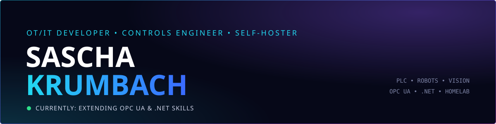

  

  
  
  

## About

I am a curious developer trying to bridge the OT/IT world. I love plc programming, robots, vision sensors, and dotnet.

I am currently extending my skills around OPC/UA and dotnet. I have a few projects I am working on. One is to collect images from various vision systems and store them in a central system.

South Carolina, USA

## Featured repos

  
  

## GitHub stats

  
  

  

  

## Experience

| When | Role | Company |
|---|---|---|
| May 2024 – Present | Controls Engineer Specialist | BMW Manufacturing Co., LLC |
| May 2023 – May 2024 | Controls Engineer | Linamar Corporation |
| Mar 2021 – Mar 2023 | Service Technician | HAHN Automation |
| Dec 2019 – Feb 2021 | Manufacturing Engineer | Continental |
| Feb 2012 – Dec 2019 | Engineering Technician | Continental |
| Aug 2002 – May 2012 | Mechatronic Technician | Continental |

**Robots:** KUKA KRC4 • Mitsubishi Melfa 5 / CR2D / CR750 / CR800 • ABB IRC5 
**PLC & CNC:** Siemens S7 (Ladder / Graph) • Siemens S5 • Sinumerik 840D-PL / 840D SL Safety Integrated

[Full profile on LinkedIn →](https://www.linkedin.com/in/sascha-k-044458a2/)

## Connect

[LinkedIn](https://www.linkedin.com/in/sascha-k-044458a2/) · [GitHub](https://github.com/skrumbach) · [skrumbach.com](https://skrumbach.com)

CODE. EXPERIMENT. AUTOMATE. SELF-HOST. REPEAT.
